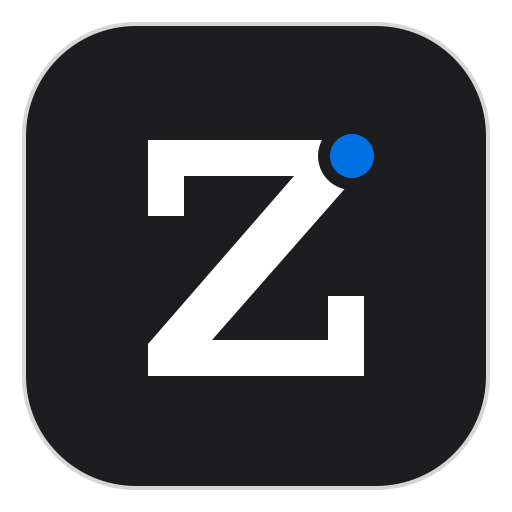
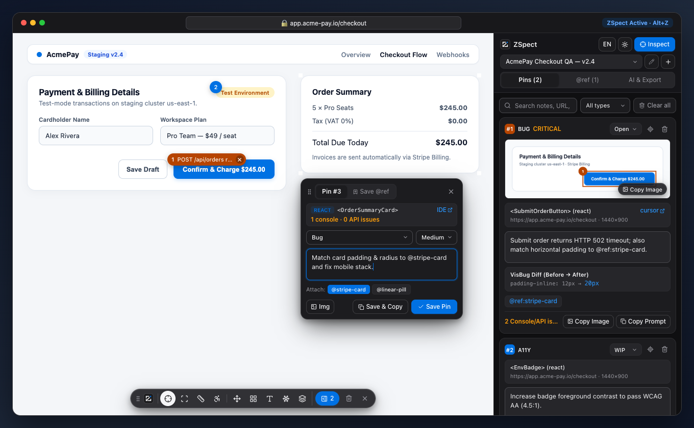
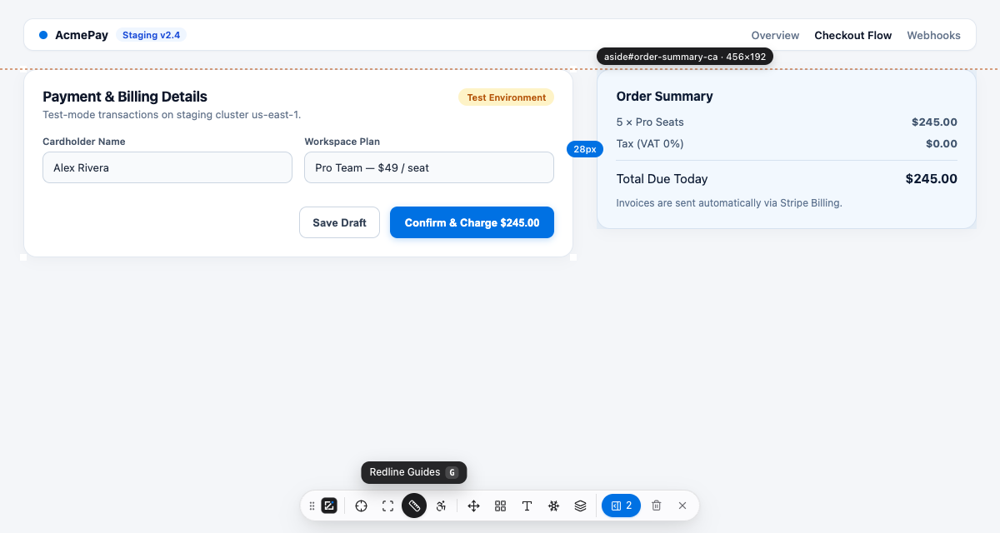
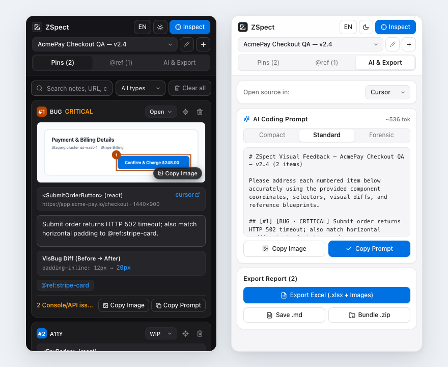
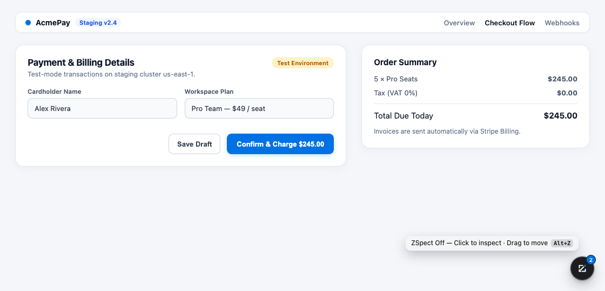
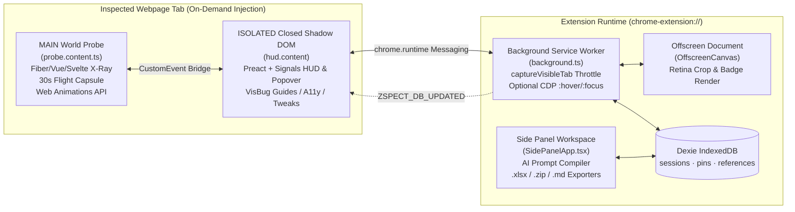

<p align="center">
  
</p>

<h1 align="center">ZSpect</h1>

<p align="center">
  <strong>Universal Zero-Install Visual Inspector, Cross-Site <code>@ref</code> Vault, VisBug Diff Engine &amp; AI/QA Exporter</strong>
</p>

<p align="center">
  
  
  
  
  
</p>

<p align="center">
  <a href="#why-zspect">Why ZSpect</a> ·
  <a href="#key-features">Key Features</a> ·
  <a href="#keyboard-shortcuts">Shortcuts</a> ·
  <a href="#architecture">Architecture</a> ·
  <a href="#getting-started">Installation</a> ·
  <a href="#export-formats">Exports</a>
</p>

<p align="center">
  
</p>

---

## Overview

**ZSpect** is a standalone **Manifest V3 Browser Extension** for Chrome, Arc, Brave, and Edge that lets developers, designers, and QA engineers inspect **any webpage** (`localhost`, staging, production, or any public website), tweak layouts live, extract reference design DNA across tabs, and export structured bug reports or AI coding prompts — **without installing an `npm` package or running a local CLI daemon**.

Press **`Alt + Z`** on any tab to mount ZSpect on demand (`0 KB` idle overhead on uninspected pages).

---

## Why ZSpect?

Tools like [Agentation](https://www.agentation.com/) require embedding a dev-dependency inside your application repository, making them unavailable on staging/production builds, third-party websites, or non-React stacks. Tools like [ProjectVisBug](https://github.com/GoogleChromeLabs/ProjectVisBug) allow live visual nudges in the browser, but discard your changes on reload and lack structured QA or AI exports.

| Capability | ZSpect | Agentation | ProjectVisBug | Browser DevTools |
| :--- | :---: | :---: | :---: | :---: |
| **Works on any URL (`localhost`, staging, prod, 3rd-party)** | **Yes (Zero-Install)** | Dev repo only | Yes | Yes |
| **Framework Component & Source X-Ray (`IDE://` links)** | **React, Vue, Svelte, Astro, Angular** | React | No | Extension per framework |
| **Cross-Tab `@ref` Design DNA Vault** | **Yes** | No | No | No |
| **Live Box-Model / Flex / Text Tweaks + `Undo/Redo`** | **Yes (`Before → After` Diff)** | No | Tweaks only (ephemeral) | Manual CSS |
| **Ghost-State Freeze (`:hover` / `:focus`) & Motion Scrubber** | **Yes (`0%–100%`)** | No | No | Partial |
| **30s Flight Recorder (Console + Failed API + Secret Redaction)** | **Automatic** | No | No | Manual copy |
| **Multi-Page QA Session & `.xlsx` (Embedded Images) / `.zip` / `.md`** | **Yes** | Prompt copy | No | No |

---

## Key Features

### 1. Zero-Install Framework & Source X-Ray (`MAIN` World Probe)
- Detects component hierarchies and source file coordinates (`filepath:line:column`) across **React 16–19 (Fiber)**, **Vue 3**, **Svelte**, **Astro**, and **Angular** while filtering out minified 1–2 character production symbols.
- Generates one-click deep links to open the exact component line in **Cursor** (`cursor://`), **VS Code** (`vscode://`), or **Windsurf** (`windsurf://`).
- Extracts clean, token-efficient HTML skeletons, resolved CSS Custom Properties (`--var`), and equivalent **Tailwind CSS v4** utility hints even on minified production sites.

### 2. VisBug Visual Toolkit + `Diff-to-Pin` Engine
- **Redline Guides (`G`)**: Select an anchor element and hover any target to render pixel-accurate `top / right / bottom / left` distance pills and alignment lines.
- **Live WCAG 2.1 Accessibility X-Ray (`A`)**: Computes real foreground/background contrast ratios (walking through semi-transparent ancestor layers), **AA / AAA Pass/Fail** status, ARIA roles, and `< 44×44px` touch-target warnings.
- **Keyboard Spacing (`P` / `M`) & Flexbox (`F`) Tuner**: Nudge padding/margin with arrow keys (`+1px`, `Shift` `+4px`, `Alt` shrink), switch Flex direction/alignment, reorder sibling DOM nodes, or edit copy inline (`T`) with full **`Cmd/Ctrl + Z` Undo/Redo**.
- **Automatic `Before → After` Diff**: Every visual tweak is recorded as a structured CSS/text diff and attached directly to your Pin, AI Prompt, Markdown, and Excel report.

<p align="center">
  
</p>

### 3. Cross-Tab `@ref` UI Vault
- Open any reference site (e.g., Stripe, Linear, Apple), inspect a component, and save it to the **`@ref` Vault**.
- ZSpect captures a preview thumbnail, clean DOM skeleton, resolved CSS tokens, layout/typography properties, `::before`/`::after` styles, and CSS transition/keyframe curves.
- Switch back to your project tab and attach `@ref:stripe-card` to any Pin so AI coding agents (Claude Code, Cursor, Antigravity, Windsurf, Copilot) receive exact reference tokens alongside the target bug.

### 4. Ghost-State Freeze, CDP Pseudo-Lock & Motion Scrubber
- Press **`Alt + Shift + F`** (or select the Freeze tool) to swallow `mouseleave`, `blur`, and `pointerout` events so ephemeral tooltips, popovers, and dropdown menus stay open while you inspect them.
- Opt-in **Chrome DevTools Protocol (`debugger`)** toggle forces native `:hover`, `:focus`, and `:active` pseudo-classes at the browser engine level.
- Built-in **Web Animations Scrubber** pauses `document.getAnimations()` and lets you scrub keyframe/CSS transitions frame-by-frame from `0%` to `100%`.

### 5. 30-Second Flight Recorder & Automatic Secret Redactor
- Maintains a lightweight rolling 30-second ring buffer of user breadcrumbs (`click`, `input`, `submit`), `console.error` / unhandled promise rejections, and failed (`status >= 400`) or slow (`>= 1500ms`) `fetch` / `XMLHttpRequest` calls.
- **Privacy-First Redaction**: Automatically masks `Authorization` headers, `Bearer` tokens, JWTs, API keys, cookies, sensitive query parameters, and `input[type="password"]` values with `[REDACTED]` before storing or exporting.

### 6. High-Density Side Panel Workspace, Themes & Multi-Format Exports
- **Persistent Multi-Page Sessions**: Collect numbered pins across multiple routes and domains inside Chrome's native **Side Panel** backed by `IndexedDB` (`Dexie`).
- **Light & Dark Pro Themes + Bilingual UI**: Instant synchronization between Side Panel and Floating HUD in **Apple Gallery Light** or **Apple Pro Dark** mode, with **English (`EN`, default)** and **Vietnamese (`VI`)** localization.
- **Image + Prompt Clipboard**: Copy individual annotated region screenshots, composite multi-pin overview sheets, or token-budgeted AI Prompts (`Compact` / `Standard` / `Forensic`).

<p align="center">
  
</p>

### 7. Draggable HUD, Hover-to-Delete Pins & Agentation-Style Pause Mode
- **Ultra-Slim Draggable UI**: Both the `38px` Floating HUD Dock and the `316px` Pin Composer Popover can be dragged anywhere in the viewport.
- **Quick Pin Management**: Hover any numbered pin marker on the webpage to preview its note and click **`✕`** to delete it inline (automatically re-indexing remaining pins), or clear all session pins in two clicks.
- **Circular Logo Minimize Mode (Off / Paused)**: Click **`×`**, click the HUD ZSpect logo, or press **`Esc`** to collapse ZSpect into a draggable `44×44px` circular Logo button in the corner — completely detaching page event listeners so you can use the website normally until you click to resume.

<p align="center">
  
</p>

---

## Keyboard Shortcuts

| Shortcut | Context | Action |
| :--- | :--- | :--- |
| `Alt + Z` | Browser-wide | Launch ZSpect on the active tab, or toggle between Active HUD and Minimized Logo mode |
| `Alt + Shift + F` | Browser-wide | Immediately freeze ephemeral tooltips/dropdowns and pause animations |
| `I` | Active HUD | **Inspect Element** — click any element (or highlight text) to pin feedback or save `@ref` |
| `R` | Active HUD | **Capture Area** — drag a marquee rectangle to capture any viewport region |
| `G` | Active HUD | **Redline Guides** — click an anchor element, then hover targets to measure distances |
| `A` | Active HUD | **WCAG Contrast** — live AA/AAA contrast ratio, role, and touch-target audit |
| `P` / `M` | Active HUD | **Box Spacing** — nudge `padding` (`P`) or `margin` (`M`) on selected element(s) |
| `F` | Active HUD | **Flex & Reorder** — adjust Flex direction/justify and reorder sibling elements |
| `T` | Active HUD | **Live Text Edit** — edit text inline on the page and record `Before → After` copy diffs |
| `D` | Active HUD | **Overlay Diff** — capture a *Before* snapshot or paste (`Cmd/Ctrl + V`) a Figma mockup for Onion-Skin / Split-Wipe comparison |
| `↑ ↓ ← →` | Spacing / Flex / Diff | Nudge spacing (`Shift` = `4px`, `Alt` = negative), reorder siblings, or align overlay |
| `Cmd/Ctrl + Click` | Inspect / Spacing | Multi-select elements for batch tweaks or grouped selectors |
| `Cmd/Ctrl + Z` | Active HUD | Undo visual tweak (`Cmd/Ctrl + Shift + Z` to Redo) |
| `Cmd/Ctrl + Enter` | Pin Popover | Save Pin immediately from the note `<textarea>` |
| `Esc` | Active HUD | Close open Popover → clear selection → minimize HUD into circular Logo button |

---

## Architecture

ZSpect runs as a **4-layer Manifest V3 architecture** with strict CSS and event isolation:



- **Closed Shadow DOM Shielding**: All HUD and Popover styles live inside a closed `ShadowRoot` using explicit pixel-scaled tokens (`--spacing: 4px`), resetting inherited host properties (`scrollbar-color`, `letter-spacing`, `user-select`) and blocking bubble-phase `keydown` / `focusin` leaks so host-page modals (Radix, MUI) or extensions (Grammarly, 1Password) never interfere with ZSpect inputs.

---

## Getting Started

### Prerequisites
- **Node.js** `>= 20` and **npm**
- Any Chromium-based browser (**Google Chrome**, **Arc**, **Brave**, or **Microsoft Edge**)

### Build from Source

```bash
# 1. Install dependencies
npm install

# 2. Run TypeScript check and unit tests
npm run typecheck
npm run test

# 3. Build production unpacked extension (.output/chrome-mv3)
npm run build

# 4. (Optional) Create distributable Chrome Web Store archive (.output/zspect-1.0.0-chrome.zip)
npm run zip
```

### Load Unpacked in Chrome / Arc / Brave / Edge
1. Open `chrome://extensions` in your browser.
2. Enable **Developer mode** (top-right toggle).
3. Click **Load unpacked** and select the generated `.output/chrome-mv3` folder.
4. Open any `http://` or `https://` webpage and click the **ZSpect** toolbar icon (or press **`Alt + Z`**).

### Development Mode (HMR)

```bash
npm run dev
```

---

## Export Formats

ZSpect compiles your session pins and `@ref` blueprints into four developer- and QA-ready outputs:

1. **AI Coding Prompt (`Compact` · `Standard` · `Forensic`)** — Structured Markdown with live token estimation, component stacks, resilient CSS selectors, `Before → After` VisBug diffs, `@ref` token tables, and 30s error logs.
2. **Excel QA Workbook (`.xlsx`)** — Generated 100% client-side via `ExcelJS` with two sheets:
   - **`Feedback & Bug List`**: Styled header, severity color coding (`CRITICAL`, `HIGH`, `MEDIUM`, `LOW`), auto-sized rows, and **annotated PNG screenshots embedded directly inside each row**.
   - **`Technical Context`**: Full selectors, component paths, computed CSS, VisBug diffs, and console/network diagnostics.
3. **Portable Zip Archive (`.zip`)** — Packaged via `fflate` containing `report.md`, `screenshots/pin-01.png...`, and `references/ref-*.png`.
4. **Standalone Markdown (`.md`) & Composite Image Sheet** — Instant single-file Markdown download or one-click copy of a stitched PNG contact sheet to paste directly into Slack, Linear, GitHub Issues, or AI chat.

---

## Project Structure

```text
ZSpect/
├── assets/
│   ├── brand/                 # Official ZSpect vector/raster logos & brand kit
│   └── screenshots/           # Product screenshots used in documentation
├── public/icon/               # Extension icons (16, 32, 48, 128px)
├── src/
│   ├── core/
│   │   ├── dom-cleaner/       # Shadow DOM piercing, resilient selectors & HTML sanitizer
│   │   ├── i18n/              # Synced English (default) & Vietnamese dictionary
│   │   ├── prompt-compiler/   # Token-budgeted AI prompt compiler & IDE deep-links
│   │   ├── redactor/          # Secret/JWT/cookie/password redaction engine
│   │   ├── style-dna/         # CSS var resolver, pseudo/motion extractor & Tailwind v4 hints
│   │   ├── theme/             # Synced Light & Dark mode hook
│   │   └── visbug-tools/      # Redline guides, WCAG 2.1 contrast & tweak Undo/Redo engine
│   ├── db/                    # Dexie IndexedDB schema & cross-context sync notifications
│   ├── entrypoints/
│   │   ├── background.ts      # MV3 Service Worker, screenshot throttle & optional CDP lock
│   │   ├── probe.content.ts   # MAIN world framework X-Ray & 30s Flight Recorder
│   │   ├── hud.content/       # ISOLATED Closed Shadow DOM HUD, Popover & Circular FAB
│   │   ├── offscreen/         # OffscreenCanvas high-DPI cropper & badge renderer
│   │   └── sidepanel/         # Side Panel Workspace UI
│   ├── exporters/             # .xlsx (ExcelJS), .zip (fflate), .md & Canvas image sheet
│   ├── styles/                # Apple Gallery Light & Pro Dark design tokens
│   └── types/                 # Shared TypeScript contracts & runtime message union
├── tests/unit/                # Vitest unit & exporter integration suites
├── DESIGN.md                  # Visual design system specification
└── wxt.config.ts              # WXT Manifest V3 configuration
```

---

## Privacy & Security

- **100% Local Execution**: All sessions, screenshots, and `@ref` items are stored locally in your browser's `IndexedDB`. ZSpect makes **zero** external analytics, telemetry, or cloud API requests.
- **Zero Idle Overhead**: Content scripts are injected programmatically (`registration: 'runtime'`) only when you activate ZSpect on a tab.
- **Automatic Credential Redaction**: Sensitive headers, tokens, query strings, and password inputs are scrubbed prior to storage and export.

---

## License

MIT
