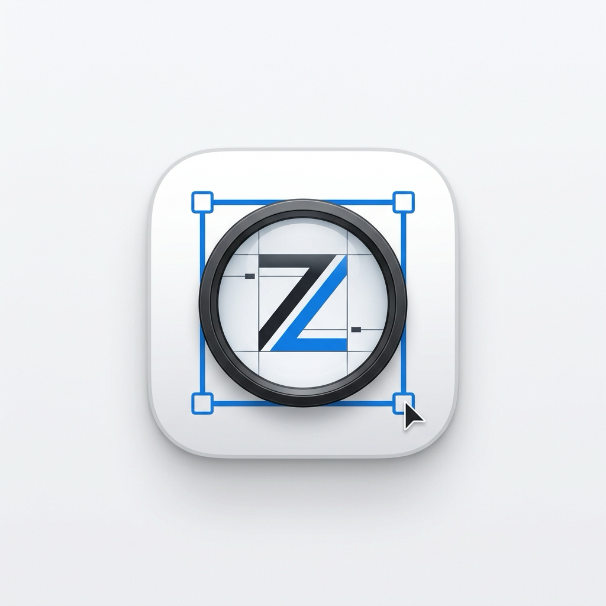

# ZSpect — Universal Zero-Install UI Inspector & AI Feedback Extension

<p align="center">
  
</p>

**ZSpect** là Browser Extension độc lập (**100% Pure Extension · Zero-CLI · Manifest V3**) giúp bạn inspect, đo đạc, chỉnh thử giao diện kiểu VisBug, bắt mẫu thiết kế xuyên tab (`@ref`) và xuất báo cáo chuẩn **AI Prompt / `.md` / `.xlsx` (Excel kèm ảnh chụp đánh dấu)** trên **mọi trang web** (`localhost`, `staging`, `production` hay bất kỳ website nào trên Internet) — **không cần cài đặt dev-package vào dự án** như Agentation.

---

## Tính năng Đột phá

1. **Zero-Install Framework & Source X-Ray (`MAIN` World Probe):**
   - Tự động nhận diện cây Component của **React (16–19 Fiber)**, **Vue 3**, **Svelte**, **Astro**, **Angular** kèm tọa độ file nguồn (`filepath:line:col`) và liên kết mở thẳng **Cursor (`cursor://`) / VS Code (`vscode://`) / Windsurf (`windsurf://`)**.
   - Trên các trang Production đã minify: tự động giải mã CSS Custom Properties (`--token`) và gợi ý class **Tailwind CSS v4** tương đương.
2. **Cross-Tab `@ref` UI Vault (Bắt mẫu xuyên Tab):**
   - Mở bất kỳ trang web mẫu nào (`linear.app`, `stripe.com`, `apple.com`...), lưu **UI DNA** (cấu trúc DOM sạch, Design Tokens, Flexbox/Grid, `::before`/`::after`, `@keyframes`/`cubic-bezier` và ảnh chụp) vào khay nhớ `@ref`, rồi gắn trực tiếp vào ghim yêu cầu sửa giao diện ở tab dự án.
3. **Bộ công cụ Trực quan Kiểu VisBug + Engine `Diff-to-Pin`:**
   - `G` — **Redline Guides & Ruler:** Đo khoảng cách từng pixel (`top/right/bottom/left`) và đường gióng thẳng hàng trực tiếp trên màn hình.
   - `A` — **WCAG Accessibility X-Ray:** Kiểm tra tức thì độ tương phản chữ/nền thực tế (**AA / AAA Pass/Fail**), `role`, `aria-*`, `alt` và kích thước vùng bấm `< 44×44px`.
   - `P` / `M` — **Keyboard Box-Model Tuner:** Dùng phím mũi tên (`↑ ↓ ← →`, giữ `Shift` nhảy bước `+4px`, giữ `Alt` để giảm) chỉnh nhanh `padding`/`margin`.
   - `F` — **Flexbox & DOM Move:** Đổi nhanh hướng `row/column`, căn lề và tráo đổi vị trí phần tử anh em.
   - `T` — **Live Text Edit:** Sửa thử nội dung chữ ngay trên trang.
   - **Khắc phục nhược điểm của VisBug gốc:** Hỗ trợ `Undo/Redo (Cmd+Z)` và tự động kết xuất bảng **`Before → After Diff`** vào Ghim, AI Prompt và báo cáo `.md`/`.xlsx`.
4. **Ghost-State Freeze & Motion Scrubber (`Alt+Shift+F`):**
   - Khóa tạm các sự kiện đóng Tooltip/Dropdown/Popover, tùy chọn bật **CDP Deep Lock (`:hover` / `:focus` / `:active`)** cấp trình duyệt, và thanh kéo tua chuyển động `document.getAnimations()` từ `0% → 100%`.
5. **Flight Recorder Bug Capsule (Hộp đen 30 giây):**
   - Tự động đính kèm lịch sử thao tác (Breadcrumbs), `console.error`/Unhandled Rejections, và các API `fetch`/`XHR` lỗi hoặc chậm (`>= 1500ms`) — đi kèm bộ lọc bảo mật tự động che `[REDACTED]` cho mọi `Authorization`, `Cookie`, `JWT`, `API Key` và mật khẩu.
6. **Snapshot & Design Overlay Diff (`D`):**
   - Chụp ảnh *Before* hoặc dán trực tiếp ảnh thiết kế Figma từ Clipboard (`Cmd+V`) để soi lệch pixel bằng chế độ mờ **Onion-Skin** hoặc thanh gạt **Split Wipe**.
7. **Quản lý Đa trang & Xuất Báo cáo Chuyên nghiệp (`.xlsx`, `.md`, `.zip`):**
   - Lưu danh sách Bug/Feedback xuyên suốt nhiều URL trong **Side Panel Workspace** (`IndexedDB`).
   - Xuất bảng tính **Excel `.xlsx` 2 Sheets** định dạng sạch đẹp có **nhúng trực tiếp ảnh chụp vùng lỗi đã đánh số `#1, #2` vào từng dòng**, gói **`.zip` (`report.md` + `screenshots/`)**, hoặc file **`.md`** kèm bộ đếm Token cho AI Agent.

---

## Cài đặt & Phát triển

```bash
# Cài đặt phụ thuộc
npm install

# Chạy môi trường phát triển (tự động mở Chromium nạp sẵn ZSpect + HMR)
npm run dev

# Chạy kiểm thử tự động (Vitest)
npm run test

# Đóng gói bản Production cho Chrome / Arc / Brave / Edge (Manifest V3)
npm run build

# Nén file .zip sẵn sàng phát hành lên Chrome Web Store
npm run zip
```

### Nạp thủ công vào Chrome / Arc / Brave / Edge
1. Chạy `npm run build`.
2. Mở `chrome://extensions` và bật **Developer mode**.
3. Nhấn **Load unpacked** và chọn thư mục `.output/chrome-mv3`.
4. Nhấn biểu tượng **ZSpect** trên thanh công cụ (hoặc nhấn `Alt + Z`) trên bất kỳ trang web nào để bắt đầu inspect!

---

## Ngôn ngữ Thiết kế

Giao diện thanh công cụ kính mờ và Side Panel của ZSpect được xây dựng bằng **Preact (`~3KB`) + `@preact/signals` + Tailwind CSS v4** theo chuẩn **Apple Gallery Light** định nghĩa tại [DESIGN.md](./DESIGN.md).
