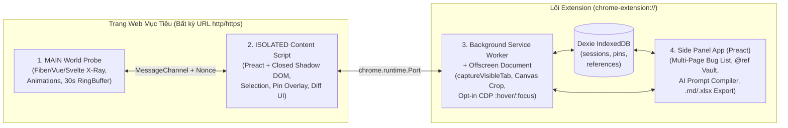

# ZSpect — Đặc tả Thiết kế Kỹ thuật & Sản phẩm (Design Specification)

- **Ngày cập nhật:** 2026-11-26
- **Trạng thái:** Draft chờ duyệt
- **Loại sản phẩm:** Browser Extension (Manifest V3, 100% Standalone / Zero-CLI)
- **Hệ thống giao diện:** Apple Gallery Light ([DESIGN.md](../../../DESIGN.md))

---

## 1. Tổng quan & Mục tiêu

### 1.1. Bài toán cần giải quyết
Các công cụ phản hồi trực quan cho AI Coding Agent như Agentation (`agentation.com`) hay `react-grab` yêu cầu lập trình viên phải cài đặt dev-package (`npm install -D ...`) và chèn component trực tiếp vào mã nguồn của từng dự án. Cách tiếp cận này có 4 hạn chế lớn:
1. Tốn công cài đặt lặp lại cho từng repository và để lại phụ thuộc trong mã nguồn.
2. Phụ thuộc vào framework cụ thể (ví dụ chỉ hỗ trợ React 18+ ở môi trường `development`).
3. Không thể inspect các bản Staging, Production, Preview hay các trang web bên thứ ba để QA báo lỗi hoặc học hỏi thiết kế.
4. Thiếu khả năng gom nhóm phản hồi đa trang để xuất thành tài liệu bàn giao chuẩn (`.md`, `.xlsx`) cho cả AI Agent lẫn đội ngũ QA/PM.

### 1.2. Giải pháp ZSpect
**ZSpect** là một Browser Extension độc lập hoàn toàn (**100% Pure Extension — Zero-CLI**), cài đặt một lần trên trình duyệt và hoạt động tức thì trên **mọi trang web** (`localhost`, `staging`, `production`, hay bất kỳ website nào trên Internet) với 4 giá trị cốt lõi:
1. **Zero-Install AI Coding Bridge:** Chấm điểm/khoanh vùng giao diện, đọc cây Component gốc (React/Vue/Svelte/Astro) + tọa độ file nguồn, mở thẳng IDE (`cursor://`, `vscode://`) và xuất gói Prompt tối ưu token kèm ảnh chụp đánh dấu.
2. **Cross-Tab `@ref` UI Vault:** Bắt "UI DNA" (cấu trúc DOM sạch, Design Tokens, Flexbox/Grid, `::before`/`::after`, `@keyframes`/`cubic-bezier`) từ bất kỳ trang web mẫu nào (Linear, Stripe, Apple...) để ghép trực tiếp vào câu lệnh xây dựng giao diện ở tab dự án.
3. **Forensic Inspection & Diff:** Hộp đen 30 giây tự động ghi lại Console Errors, Failed/Slow API và lịch sử click; đóng băng Tooltip/Dropdown/Animation từng mili-giây (kèm chế độ nâng cao CDP Deep Lock cho `:hover`/`:focus`); phủ ảnh thiết kế Figma hoặc ảnh Before/After để soi lệch pixel.
4. **Multi-Page Session & Report Exporter (`.md` & `.xlsx`):** Lưu trữ danh sách Bug/Feedback xuyên suốt nhiều trang trong cùng một phiên kiểm thử và xuất ra file `.md` (hoặc `.zip` gồm `.md` + ảnh) cho AI/GitHub, hoặc file `.xlsx` chuyên nghiệp có nhúng ảnh trực tiếp vào ô Excel cho QA/PM/Khách hàng.

### 1.3. Ranh giới ngoài phạm vi (Non-Goals)
- **Không** yêu cầu chạy bất kỳ Node.js CLI, daemon nền hay local MCP server nào trên máy người dùng.
- **Không** xây dựng trình kéo-thả chỉnh sửa CSS trực tiếp kiểu WYSIWYG page-builder.
- **Không** gửi dữ liệu trang web, ảnh chụp hay log lên bất kỳ máy chủ đám mây nào (100% Local-first trong trình duyệt).

---

## 2. Công nghệ Cốt lõi (Tech Stack)

| Thành phần | Lựa chọn kỹ thuật | Lý do lựa chọn |
|---|---|---|
| **Extension Framework** | `WXT` (Manifest V3, TypeScript strict, Vite) | Hỗ trợ chuẩn hóa `MAIN` world script, Closed Shadow DOM UI, Side Panel, HMR nhanh và build đa trình duyệt (Chrome, Arc, Edge, Brave, Firefox). |
| **UI Runtime** | **Preact** (`preact` ~3KB + `@preact/signals`) | Siêu nhẹ cho Content Script tiêm vào trang web (mount `< 5ms`), đồng thời dùng `@preact/signals` cập nhật tọa độ chuột & thanh kéo animation ở 60fps không gây re-render thừa. |
| **Styling & Design Tokens** | **Tailwind CSS v4** (`@theme` từ `DESIGN.md`) | Áp dụng chính xác bảng màu, font scale, negative tracking và bo góc chuẩn Apple Gallery Light; biên dịch CSS cô lập hoàn toàn trong Shadow DOM và Side Panel. |
| **Lưu trữ cục bộ** | `Dexie` (`IndexedDB` nội bộ Extension) | Lưu trữ mượt các ảnh chụp `Blob` độ phân giải cao, danh sách Bug đa trang và kho `@ref` mà không chạm giới hạn dung lượng hay tốn chi phí tuần tự hóa JSON của `chrome.storage`. |
| **Chụp & Vẽ ảnh** | `chrome.tabs.captureVisibleTab` + `OffscreenCanvas` | Chụp trực tiếp đầu ra từ GPU trình duyệt (hiển thị chính xác 100% cả WebGL, `oklch`, `backdrop-filter`, cross-origin images — khắc phục lỗi trắng ảnh của `html2canvas`). |
| **Xuất báo cáo** | `ExcelJS` (`.xlsx`) + `fflate` (`.zip` cho gói `.md`) | Tạo bảng tính Excel có định dạng, cố định tiêu đề, nhúng ảnh PNG trực tiếp vào ô và nén nhanh bộ báo cáo Markdown offline ngay trong Side Panel. |
| **Kiểm thử** | `Vitest` + `Playwright` (Chromium Extension) | Đảm bảo độ chính xác cho các bộ trích xuất DOM/Fiber, bộ lọc bảo mật, trình tạo `.md`/`.xlsx` và luồng tương tác thực tế trên trình duyệt. |

---

## 3. Hệ thống Giao diện theo `DESIGN.md` (Apple Gallery Light)

Toàn bộ bề mặt hiển thị của ZSpect tuân thủ nghiêm ngặt các quy tắc thẩm mỹ trong [DESIGN.md](../../../DESIGN.md) để giữ vẻ tối giản, sắc sảo và không gây nhiễu thị giác lên website đang được inspect:

### 3.1. Bảng ánh xạ Token chính
- **Canvas & Surfaces:**
  - `Gallery White` (`#ffffff`): Bề mặt thẻ Pin, thẻ `@ref`, khung nhập chú thích nổi (Pin Popover) và thanh điều hướng cục bộ trong Side Panel.
  - `Studio Mist` (`#f5f5f7`): Nền tổng thể của Side Panel Workspace, vùng hiển thị đoạn mã/token thu gọn và tiêu đề bảng.
  - `Paper Frost` (`#fafafc` / `rgba(250, 250, 252, 0.88)` + `backdrop-filter: blur(20px)`): Thanh điều khiển nổi (Floating HUD) trên trang web.
  - `Hairline Silver` (`#d6d6d6`) & `Control Gray` (`#e6e6e8`): Đường kẻ phân tách `1px` và viền khung (`0 0 0 1px`), **tuyệt đối không sử dụng đổ bóng đậm (heavy drop shadows) hay dải màu chuyển (gradients)**.
- **Typography (`SF Pro Display` & `SF Pro Text` / hệ font `-apple-system, Inter`):**
  - Nhãn điều khiển & nút bấm nhỏ: `12px/400` hoặc `12px/600`, line-height `1.33`, tracking `-0.12px`.
  - Nội dung chú thích & danh sách trong Side Panel: `14px/400`, line-height `1.29`, tracking `-0.224px`.
  - Tiêu đề mục trong Side Panel: `19px/600` (`SF Pro Display`), line-height `1.21`, tracking `+0.228px`.
- **Màu nhấn & Điều khiển (Controls & Accents):**
  - **Nút hành động chính (`Pricing Blue Pill`):** Nền `#0071e3`, chữ `#ffffff` `12px`, bo tròn tuyệt đối `9999px` — chỉ dùng cho các hành động chốt (`Lưu ghim`, `Copy cho AI`, `Xuất báo cáo`).
  - **Nút phụ (`Outlined Explore Pill`):** Nền trong suốt, viền `1px solid #86868b` (`Steel`), chữ `#1d1d1f` (`Ink`), bo tròn `9999px`.
  - **Liên kết hành động (`Apple Blue`):** `#0066cc` cho liên kết văn bản (`Mở trong Cursor`, `Mở trong VS Code`, gắn thẻ `@ref`).
  - **Nhãn mức độ nghiêm trọng / trạng thái nổi bật (`Launch Orange`):** Dùng chữ trần `#b64400` `12px/600` (không bọc trong nền pill sặc sỡ). Các thông tin phụ (viewport, thời gian, selector phụ) dùng màu `Slate` (`#707070`).
- **Bo góc (Radii):**
  - Thanh HUD nổi: `36px` (`--radius-pills`).
  - Thẻ nội dung & khung xem trước ảnh: `20px`–`28px` (`--radius-navigation` / `--radius-cards`, tự động dùng `20px` ở chế độ Side Panel hẹp dưới `380px` và `28px` cho khung lớn).
  - Ô tìm kiếm/lọc: `980px` (`--radius-inputs`), viền `1px solid #86868b`.

### 3.2. Lớp phủ Inspect trên trang (Canvas & Markers)
- Khung bao phần tử đang trỏ chuột: nét liền `1.5px solid #0071e3`, lớp phủ nền rất nhẹ `rgba(0, 113, 227, 0.06)`.
- Khung bao phần tử mẫu `@ref`: nét đứt mảnh `1.5px dashed #1d1d1f`.
- Huy hiệu ghim đánh số (`#1`, `#2`...): hình tròn đường kính `22px`, nền `#1d1d1f` (chuyển sang `#0071e3` khi đang chọn), chữ trắng `12px/600`, viền mảnh `1px solid #ffffff` để luôn rõ nét trên cả nền sáng lẫn nền tối của website mục tiêu.

---

## 4. Kiến trúc 4 Tầng & Ranh giới Module

### 4.1. Sơ đồ kiến trúc thực thi



### 4.2. Cơ chế kích hoạt & Quyền trình duyệt (Permissions)
- **On-Demand Injection (`0 KB` khi không dùng):** ZSpect không tự bơm script nặng vào mọi trang khi người dùng lướt web bình thường. Chỉ khi người dùng nhấn biểu tượng ZSpect hoặc tổ hợp phím `Alt+Z` trên tab hiện tại, Background Worker mới dùng `chrome.scripting.executeScript` tiêm `HUD` (`ISOLATED` world) và `Probe` (`MAIN` world).
- **Kênh giao tiếp nội bộ an toàn:** `HUD` tạo một `MessageChannel` riêng, gửi `port2` kèm mã `nonce` một lần sang `Probe` để thiết lập đường truyền điểm-nối-điểm. Sau bước bắt tay, `Probe` bỏ qua mọi sự kiện `window.postMessage` công khai nhằm ngăn chặn script của website giả mạo dữ liệu.
- **Quyền trong `manifest.json`:**
  - `permissions`: `["activeTab", "scripting", "storage", "sidePanel", "offscreen", "clipboardWrite", "unlimitedStorage"]`
  - `host_permissions`: `["<all_urls>"]` (phục vụ chụp ảnh vùng nhìn và duy trì phiên kiểm thử xuyên trang khi người dùng bật chế độ thu thập đa URL trong cùng một Session).
  - `optional_permissions`: `["debugger"]` (chỉ yêu cầu cấp quyền lần đầu khi người dùng chủ động bật tính năng **CDP Deep Lock**).

### 4.3. Cấu trúc thư mục dự án

```text
ZSpect/
├── DESIGN.md
├── wxt.config.ts
├── package.json
├── src/
│   ├── entrypoints/
│   │   ├── background.ts             # Điều phối tab, chụp ảnh, quản lý CDP debugger
│   │   ├── offscreen/                # OffscreenCanvas cắt ảnh & vẽ huy hiệu #1, #2
│   │   ├── hud.content/              # Preact UI trong Closed Shadow DOM trên trang
│   │   ├── probe.content.ts          # Script MAIN world (Fiber, Animations, 30s Recorder)
│   │   └── sidepanel/                # Preact App quản lý Session, @ref Vault & Export
│   ├── core/
│   │   ├── messaging/                # Định nghĩa giao thức bản tin có kiểu (Typed RPC)
│   │   ├── dom-cleaner/              # Lọc rác HTML/SVG, tạo CSS selector bền vững
│   │   ├── style-dna/                # Giải mã CSS variables, layout, keyframes & Tailwind hint
│   │   ├── redactor/                 # Ẩn token, cookie, mật khẩu trong log & DOM
│   │   └── prompt-compiler/          # Biên dịch ngữ cảnh sang Markdown/XML + đếm token
│   ├── db/
│   │   └── schema.ts                 # Định nghĩa bảng Dexie IndexedDB & CRUD repositories
│   ├── exporters/
│   │   ├── markdown-exporter.ts      # Sinh file .md đơn lẻ hoặc gói .zip (.md + ảnh)
│   │   └── excel-exporter.ts         # Sinh file .xlsx 2 sheets nhúng ảnh bằng ExcelJS
│   └── styles/
│       └── design-tokens.css         # Tailwind v4 @theme ánh xạ trực tiếp từ DESIGN.md
└── tests/
    ├── unit/                         # Vitest cho dom-cleaner, style-dna, redactor, exporters
    └── e2e/                          # Playwright kiểm thử luồng Extension trên Chromium
```

---

## 5. Đặc tả Chi tiết các Phân hệ Tính năng

### 5.1. Đa chế độ Chọn & Gắn ghim (Multi-Mode Inspector)
Thanh HUD nổi cung cấp 4 chế độ chọn trực quan:
1. **Element Inspect (Mặc định):** Rê chuột xem kích thước, khoảng cách padding/margin và tên Component. `Click` để mở khung chú thích cho 1 phần tử; `Cmd/Ctrl + Click` để gom nhiều phần tử vào cùng một mục phản hồi.
2. **Text Selection:** Bôi đen đoạn văn bản trực tiếp trên trang để góp ý lỗi chính tả/nội dung (lưu cả chuỗi văn bản gốc và phần tử chứa nó).
3. **Area Drag:** Kéo chuột tạo vùng chữ nhật tự do (hữu ích khi cần chỉ ra khoảng trống bố cục hoặc nhiều thành phần nằm chồng nhau).
4. **Shadow DOM Piercing:** Bộ dò tọa độ sử dụng đệ quy `shadowRoot.elementFromPoint(x, y)` trên mọi `open ShadowRoot` để soi xuyên vào các Web Components hiện đại.

### 5.2. Zero-Install Framework & Source X-Ray
Khi chọn một phần tử DOM, `MAIN World Probe` thực hiện chuỗi nhận diện không xâm lấn:
- **React (16–19):** Đọc khóa `__reactFiber$*` trên phần tử DOM, duyệt ngược cây `return` để lấy chuỗi tên Component có nghĩa (bỏ qua các wrapper ẩn danh), trích xuất `memoizedProps` đã lọc gọn (ẩn hàm & vòng lặp tham chiếu), và đọc `_debugSource` hoặc phân tích stack frame sourcemap trên môi trường dev để lấy `filePath:lineNumber:columnNumber`.
- **Vue 3 / Nuxt:** Đọc `__vueParentComponent` (`type.__name` / `type.__file`, `props`).
- **Svelte / SvelteKit:** Đọc `__svelte_meta` (`loc.file`, `loc.line`, `loc.column`).
- **Astro:** Nhận diện thẻ `<astro-island>` (`component-url`, `component-export`, `props`).
- **Mở nhanh IDE:** Khi phát hiện đường dẫn file cục bộ, HUD và Side Panel hiển thị liên kết mở một chạm `cursor://file/<absPath>:<line>:<col>` hoặc `vscode://file/<absPath>:<line>:<col>` (người dùng chọn trình sửa code mặc định trong cài đặt).
- **Fallback trên trang Production đã Minify:** Khi không có sourcemap, bộ `style-dna` tự động trích xuất danh sách CSS Custom Properties đang áp dụng (`--token: giá trị thực`) và dịch ngược các thuộc tính bố cục/màu/chữ trọng yếu sang gợi ý utility classes chuẩn Tailwind CSS v4.

### 5.3. Cross-Tab `@ref` UI Vault (Bắt mẫu xuyên Tab)
1. Tại bất kỳ trang web tham khảo nào (ví dụ `linear.app`), người dùng chọn phần tử và bấm **"Lưu vào `@ref`"**.
2. ZSpect tự động đặt tên gợi ý (ví dụ `@ref:linear-feature-card`, cho phép đổi tên) và trích xuất gói **UI DNA**:
   - `domSkeleton`: Cấu trúc HTML tối giản (giữ thẻ ngữ nghĩa, cắt nội dung văn bản dài, thu gọn thẻ `<svg>` phức tạp thành `<svg viewBox="..." data-zspect-icon="WxH">`).
   - `resolvedStyles`: Bố cục (`display`, `flex*`, `grid*`, `gap`, `padding`, `width/height`), bề mặt (`background`, `backdrop-filter`, `border`, `border-radius`, `box-shadow`, `opacity`, `mix-blend-mode`), chữ (`font-family`, `font-size`, `font-weight`, `line-height`, `letter-spacing`, `color`).
   - `pseudoLayers`: Kiểu dáng của `::before` và `::after` (nếu `content !== 'none'`).
   - `motionRules`: Toàn bộ `transition`, `animation` và quy tắc `@keyframes` kèm đường cong `cubic-bezier(...)` đang gắn với phần tử.
   - `tailwindHint`: Chuỗi class Tailwind tương đương.
   - `previewBlob`: Ảnh chụp phần tử mẫu.
3. Khi chuyển sang tab dự án (`localhost:3000`), trong lúc tạo ghim mới, người dùng gõ `@` hoặc chọn mẫu từ khay `@ref` để đính kèm toàn bộ bản thiết kế mẫu đó vào cùng một Prompt gửi cho AI.

### 5.4. Ghost-State Freeze & Motion Scrubber
- **Khóa trạng thái nhanh (`Alt+Shift+F` — Không cần quyền Debugger):**
  - Chặn tức thì các sự kiện `mouseleave`, `mouseout`, `pointerleave`, `pointerout`, `blur`, `focusout` ở pha `capture` trên `window` và tạm ngưng các bộ đếm đóng popover phổ biến để giữ nguyên Tooltip/Dropdown đang mở trên màn hình.
- **CDP Deep Lock (Tùy chọn nâng cao):**
  - Khi người dùng bật nút `Deep Lock (:hover / :focus)`, Background Worker gắn `chrome.debugger.attach({ tabId }, "1.3")`, gọi `DOM.enable`, `CSS.enable`, tìm `nodeId` tương ứng và thực thi `CSS.forcePseudoState` với mảng trạng thái người dùng chọn (`["hover"]`, `["focus", "focus-within"]`, `["active"]`).
  - Ngay khi người dùng tắt `Deep Lock`, chuyển tab khác hoặc đóng HUD, Background gọi `chrome.debugger.detach` tức khắc để trả lại giao diện trình duyệt sạch không còn thanh cảnh báo vàng.
- **Motion Scrubber (`0% -> 100%`):**
  - Thu thập `document.getAnimations({ subtree: true })` trên trang hoặc trong phạm vi phần tử đang chọn.
  - Bấm `Pause` để dừng toàn bộ chuyển động; kéo thanh trượt phần trăm hoặc nhập số mili-giây cụ thể để gán `anim.currentTime`, giúp chụp lại chính xác khoảnh khắc giao diện bị vỡ giữa chừng khi đang chuyển cảnh.

### 5.5. Flight Recorder Bug Capsule (Hộp đen 30 giây)
Khi ZSpect đang bật trên một tab, `Probe` duy trì bộ đệm vòng nhẹ trong RAM (chỉ lưu tối đa **30 giây gần nhất** hoặc **50 bản ghi**, tự xóa bản ghi cũ):
1. **User Breadcrumbs:** Ghi lại tối đa 8 thao tác gần nhất (`click`, `input` chỉ ghi độ dài/trạng thái không ghi mật khẩu, `submit`, `popstate` chuyển route) kèm tên phần tử gọn nhẹ.
2. **Console & Runtime Exceptions:** Bắt `console.error`, `console.warn`, `window.onerror` và `unhandledrejection` (lưu thông điệp + 5 dòng đầu của stack trace).
3. **Failed & Slow Network Calls:** Bọc nhẹ `window.fetch` và `XMLHttpRequest` để chỉ ghi lại các request bị lỗi mạng, có mã trạng thái `>= 400`, hoặc thời gian phản hồi `>= 1500ms` (ghi `method`, `url` đã lọc token trên query string, `status`, `durationMs`, và tối đa `1 KB` phần đầu response lỗi dạng văn bản/JSON).
4. **Quy tắc Bảo mật (Redaction bắt buộc):** Mọi khóa khớp biểu thức `/(authorization|cookie|set-cookie|token|secret|password|api[-_]?key|session)/i` trong URL query, headers hoặc JSON body đều bị thay thế cứng bằng `"[REDACTED]"` ngay trong `Probe` trước khi truyền sang Content Script. Các ô `<input type="password">` và phần tử gắn `[data-sensitive]` được làm mờ trên ảnh chụp.

### 5.6. Snapshot & Design Overlay Diff
- **2 nguồn ảnh đối chiếu:**
  1. **Capture "Before" Snapshot:** Chụp lại vùng nhìn hiện tại của trang web trước khi yêu cầu AI sửa code, để sau khi trang reload có thể đối chiếu ngay kết quả *Before vs After*.
  2. **Paste/Upload Design Mockup:** Dán trực tiếp ảnh frame xuất từ Figma trong Clipboard (`Cmd+V`) hoặc chọn file ảnh PNG/WebP từ máy.
- **2 chế độ hiển thị so sánh:**
  - `Onion-Skin`: Điều chỉnh độ mờ từ `0%` đến `100%` kèm phím dịch chuyển tinh `1px` (`Arrow Keys`) và tỷ lệ co giãn (`0.5x`, `1x`, `2x` Retina) để khớp khung hình.
  - `Split Slider`: Thanh gạt dọc chia đôi màn hình (*Trái: Thiết kế / Before* — *Phải: Trang thực tế*).
- Người dùng có thể bấm gắn ghim `#1, #2` ngay trong lúc đang bật lớp phủ; ảnh chụp lưu vào Pin sẽ cho phép chọn lưu kèm lớp đối chiếu để AI hoặc Designer nhìn thấy rõ độ lệch.

### 5.7. Biên dịch AI Clipboard & Xuất báo cáo `.md` / `.xlsx`

#### A. AI Prompt Compiler & Dual-Copy
- Hiển thị **Ước tính Token** theo thời gian thực (`~Tokens = Math.ceil(charCount / 3.8)`) với 3 mức độ chi tiết:
  - `Compact`: Chỉ gồm ghi chú, đường dẫn Component/Selector và thay đổi mong muốn (~150–300 tokens/ghim).
  - `Standard` (Mặc định): Gồm thông tin Component/Selector, Computed Styles trọng yếu, mẫu `@ref` đính kèm (nếu có) và lỗi Console/API liên quan (~400–800 tokens/ghim).
  - `Forensic`: Bổ sung đầy đủ `cleanHtml`, chuỗi Breadcrumbs và chi tiết response lỗi.
- **Nút Copy thông minh:** Cho phép *Copy Prompt (Markdown)*, *Copy Annotated Image (PNG có đánh số `#1, #2`)* hoặc *Copy Cả Hai* vào Clipboard để dán thẳng vào cửa sổ chat của Claude Code, Cursor, Antigravity.

#### B. Xuất báo cáo `.md` (và gói `.zip`)
- **Chế độ `.md` độc lập:** Phù hợp khi dán vào khung chat AI hoặc lưu nhanh (chứa bảng tổng kết phiên kiểm thử, danh sách mục `#1..#N` phân nhóm theo URL, tọa độ Component/Selector, mô tả, bước tái hiện và khối log lỗi).
- **Chế độ `.zip` đầy đủ (`<session-slug>-report.zip`):** Bao gồm file `report.md` và thư mục `screenshots/pin-01.png, pin-02.png...` được liên kết tương đối chuẩn xác, sẵn sàng commit vào kho mã nguồn hoặc tải lên GitHub/GitLab.

#### C. Xuất báo cáo `.xlsx` (Excel chuyên nghiệp bằng `ExcelJS`)
File `<session-slug>-qa-report.xlsx` gồm 2 trang tính được định dạng theo bảng màu tinh gọn của `DESIGN.md` (dòng tiêu đề cố định nền `#f5f5f7`, chữ `#1d1d1f` in đậm, kẻ khung mảnh `#d6d6d6`, tự động căn chỉnh độ rộng cột và chiều cao dòng `110pt` cho dòng có ảnh):

1. **Sheet 1 — `Feedback & Bug List` (Dành cho PM, QA, Developer, Khách hàng):**
   - `Mã` (`#1`, `#2`...)
   - `Phân loại` (`Bug`, `UI Polish`, `Copy/Text`, `Design Diff`)
   - `Mức độ` (`Critical`, `High`, `Medium`, `Low` — các mức `Critical`/`High` tô chữ `#b64400` đậm)
   - `Trang & Màn hình` (URL đầy đủ + kích thước viewport `WxH`)
   - `Vị trí / Component` (Tên Component + `file:line` hoặc CSS Selector gọn)
   - `Nội dung Feedback / Mô tả lỗi` (Ghi chú của người kiểm thử + tham chiếu `@ref` nếu có)
   - `Các bước tái hiện` (Tự động điền từ User Breadcrumbs, cho phép chỉnh sửa trước khi xuất)
   - `Tóm tắt lỗi Console / API` (Số lỗi Console + mã lỗi HTTP thất bại)
   - `Ảnh minh họa` (**Nhúng trực tiếp ảnh PNG vùng lỗi đã khoanh vùng & đánh số vào đúng ô Excel** qua `ExcelJS` image anchor)
   - `Trạng thái` (`Open`, `In Progress`, `Resolved`)
2. **Sheet 2 — `Technical Details` (Dành cho Developer tra cứu sâu):**
   - Liên kết theo `Mã (#1..#N)`, chứa đầy đủ `Clean HTML`, `Computed Design Tokens`, `Full Stack Trace` và `Failed Request Details` đã che thông tin nhạy cảm.

---

## 6. Mô hình Dữ liệu (`IndexedDB` Schema)

```typescript
export type PinType = 'bug' | 'ui-polish' | 'copy' | 'design-diff';
export type PinSeverity = 'critical' | 'high' | 'medium' | 'low';
export type PinStatus = 'open' | 'in-progress' | 'resolved';

export interface SessionRecord {
  id: string;                 // UUID
  title: string;              // VD: "Checkout QA - 2026-11-26"
  activeTabCollection: boolean; // Tự động hiển thị HUD khi chuyển trang trong cùng phiên
  createdAt: number;
  updatedAt: number;
}

export interface FrameworkMeta {
  framework: 'react' | 'vue' | 'svelte' | 'astro' | 'angular' | 'unknown';
  componentName?: string;
  componentStack: string[];   // VD: ["AppLayout", "CheckoutForm", "PayButton"]
  sourceLocation?: {
    filePath: string;
    line: number;
    column?: number;
  };
  sanitizedProps?: Record<string, unknown>;
}

export interface FlightCapsule {
  breadcrumbs: Array<{ ts: number; action: string; targetLabel: string }>;
  consoleErrors: Array<{ ts: number; level: 'error' | 'warn'; message: string; stack?: string }>;
  networkIssues: Array<{
    ts: number;
    method: string;
    url: string;              // Đã lọc query nhạy cảm
    status: number | 'NETWORK_ERROR';
    durationMs: number;
    responseSnippet?: string; // Đã lọc khóa nhạy cảm, tối đa 1KB
  }>;
}

export interface PinRecord {
  id: string;
  sessionId: string;
  orderIndex: number;         // 1, 2, 3... (#1, #2, #3)
  type: PinType;
  severity: PinSeverity;
  status: PinStatus;
  note: string;
  selectedText?: string;
  pageUrl: string;
  pageTitle: string;
  viewport: { width: number; height: number; dpr: number };
  boundingBox: { x: number; y: number; width: number; height: number };
  selector: string;
  cleanHtml: string;
  computedStyles: Record<string, string>;
  tailwindHint?: string;
  frameworkMeta: FrameworkMeta;
  flightCapsule?: FlightCapsule;
  attachedRefIds: string[];   // Danh sách ID từ bảng references (@ref)
  croppedImageBlob?: Blob;    // Ảnh vùng lỗi đã vẽ khung & số thứ tự
  fullViewportBlob?: Blob;    // Ảnh toàn màn hình (tùy chọn)
  createdAt: number;
}

export interface ReferenceDNA {
  id: string;
  alias: string;              // VD: "stripe-pricing-card" -> dùng dưới dạng @ref:stripe-pricing-card
  sourceUrl: string;
  domSkeleton: string;
  resolvedCssVars: Record<string, string>;
  layoutStyles: Record<string, string>;
  visualStyles: Record<string, string>;
  pseudoElements: { before?: Record<string, string>; after?: Record<string, string> };
  motionRules: {
    transitions: string[];
    animations: string[];
    keyframesCss: string[];
  };
  tailwindHint: string;
  previewBlob?: Blob;
  createdAt: number;
}
```

---

## 7. Xử lý Ngoại lệ, Bảo mật & Kiểm thử

### 7.1. Xử lý các trường hợp biên trên thực tế
- **Trang hệ thống bị trình duyệt khóa (`chrome://`, `edge://`, Chrome Web Store):** Khi bấm mở ZSpect trên các trang này, Side Panel hiển thị thông báo lịch sự giải thích giới hạn bảo mật của trình duyệt và vẫn cho phép xem/xuất các Session hoặc kho `@ref` đã lưu trước đó.
- **Phần tử nằm trong `iframe` khác tên miền (Cross-origin iframe):** Nếu phần tử là `<iframe>` khác nguồn không thể đọc DOM bên trong do chính sách bảo mật trình duyệt, ZSpect vẫn cho phép khoanh vùng `Area Drag` và chụp ảnh hiển thị thực tế qua `captureVisibleTab`, đồng thời ghi chú rõ nguồn `iframe[src]` trong báo cáo.
- **Phần tử bị thay đổi hoặc xóa khỏi DOM sau khi gắn ghim:** Tọa độ ghim lưu cả `selector` lẫn tọa độ tuyệt đối theo trang (`pageX, pageY`). Nếu SPA render lại làm mất node cũ, ZSpect thử tìm lại bằng `selector`; nếu phần tử không còn trên trang, ghim trong Side Panel chuyển sang nhãn *"Off-screen / Unmounted"* nhưng vẫn giữ nguyên toàn bộ ảnh chụp và dữ liệu đã thu thập.
- **Giới hạn tần suất chụp màn hình của Chrome (`MAX_CAPTURE_VISIBLE_TAB_CALLS_PER_SECOND`):** Bộ điều phối chụp ảnh trong `Background` cài đặt hàng đợi điều tiết (throttle tối thiểu `600ms`/lần gọi) để không bao giờ văng lỗi vượt hạn mức khi người dùng gắn ghim liên tiếp cực nhanh.

### 7.2. Chiến lược Kiểm thử
1. **Unit Tests (`Vitest` + `happy-dom`):**
   - Kiểm thử `dom-cleaner` (cắt gọn SVG dài, loại bỏ thuộc tính rác, sinh selector duy nhất).
   - Kiểm thử `redactor` (đảm bảo 100% `Bearer token`, `Cookie`, `api_key`, `password` bị thay bằng `[REDACTED]`).
   - Kiểm thử `style-dna` & `prompt-compiler` (độ chính xác ước tính token, nhúng `@ref` đúng cấu trúc).
   - Kiểm thử `markdown-exporter` và `excel-exporter` (đọc ngược buffer `.xlsx` bằng `ExcelJS` để xác nhận đủ 2 sheets, đúng cột, đúng dòng và có ảnh đính kèm).
2. **End-to-End Tests (`Playwright` Chromium Persistent Context với Extension đã build):**
   - Kịch bản 1: Mở trang mẫu React/HTML, kích hoạt HUD, chọn phần tử, tạo ghim `#1`, kiểm tra dữ liệu & ảnh crop được lưu vào `IndexedDB`.
   - Kịch bản 2: Lưu một phần tử vào `@ref` Vault ở Tab A, chuyển sang Tab B gắn `@ref` vào ghim mới và kiểm tra nội dung Prompt xuất ra có đầy đủ cả hai ngữ cảnh.
   - Kịch bản 3: Bấm xuất file `.md` và `.xlsx` từ Side Panel, kiểm tra file tải về hợp lệ và không rỗng.
